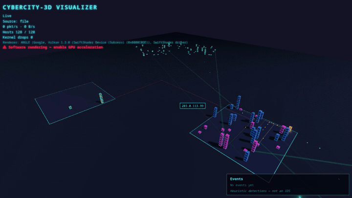
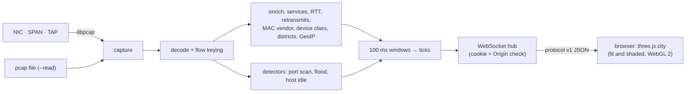

# 🏙️ CyberCity-3D

CyberCity-3D turns live network traffic into a shaded 3D city that you watch in your browser. Hosts are buildings, subnets are districts, conversations are highways and packets are freight running along them. A single Go binary captures the traffic and serves the page, and three.js renders it on your GPU through WebGL.



<sub>Recorded by the end-to-end suite (`web/e2e/record.spec.ts`) replaying the synthetic `testdata/pcap/demo.pcap` under headless software rendering. A real GPU renders it far more smoothly.</sub>

## What you are looking at

| In the city | In the network |
|---|---|
| **District** (a lit plot on the 3 × 3 grid) | A local subnet or a named district from `--districts` |
| **Building** | A host. Height follows its traffic rate (log scale), and the tint shows its heuristic device class |
| **Facade windows** | The host's service categories (web, DNS, SSH, …), seen only from server-side packets. SSH windows blink |
| **The Outlands** (rings around the city) | Non-local hosts, placed by GeoIP compass bearing when `--geoip` and `geo.home` are set (otherwise spread by address) |
| **Highways and particles** | Flows between hosts, coloured by category. Particles travel at a speed set by the measured handshake RTT |
| **Magenta glitching** | A degraded host: high RTT or retransmissions |
| **Flash and lightning** | Sudden traffic spikes |
| **Searchlight** 🔦 | A `port_scan` event: a cone from the scanner sweeps its targets |
| **Meteor shower** ☄️ | A `flood` event: the sky turns red and particles rain onto the target |
| **Power outage** 🌑 | A `host_idle` event: the windows flicker, then the building dissolves |

Events are **heuristic detections, not an IDS**. They use simple thresholds over packet metadata (see [docs/CONFIG.md](docs/CONFIG.md#event-detectors)), and the event log says so.

Keys: drag to orbit, scroll to zoom, click a building to inspect it, `F` flies to the selection, `Esc` clears it, `Space` pauses, `L` toggles low quality, and `?` shows help.

## Requirements

- Linux, Go ≥ 1.25, Node 22, and the libpcap headers:
  - Fedora: `sudo dnf install golang libpcap-devel nodejs`
  - Debian/Ubuntu: `sudo apt install golang libpcap-dev nodejs npm`
- A browser with **hardware-accelerated WebGL 2**. If the page detects software rendering (llvmpipe or SwiftShader), it shows a warning and switches to low quality.

## Quick start: no root needed

Replay the bundled synthetic capture:

```bash
make setup     # Go modules, web dependencies, Playwright browser
make build     # builds the frontend and embeds it in bin/cybercity
bin/cybercity --read testdata/pcap/demo.pcap --loop
```

Open the URL it prints (`http://127.0.0.1:8080/auth?token=…`). The one-time token logs your browser in and is removed from the address bar.

`bin/cybercity --read testdata/pcap/demo.pcap --dump-json -` prints the protocol messages instead of serving the page.

## Quick start: live capture

Live capture needs packet-capture rights. Grant them to the binary once, then run it as yourself:

```bash
make setcap && bin/cybercity   # CAP_NET_RAW + CAP_NET_ADMIN only; captures on the default-route interface
```

Alternatively, `sudo bin/cybercity` opens the capture as root and then drops to `nobody` (or `--user NAME`). `bin/cybercity --list-ifaces` lists interfaces, and `--iface` picks one.

**Visibility:** on a switched network, promiscuous mode only sees broadcast and multicast traffic plus this machine's own. To see every host, capture from a **SPAN/mirror port** or a **network TAP**.

## Security and privacy

The page shows who talks to whom on your network, so it is locked down by default. Details are in [SECURITY.md](SECURITY.md).

- **Loopback only.** It listens on `127.0.0.1` unless you choose otherwise with `--listen`, and warns when you do.
- **Token, then cookie.** The printed one-time token is exchanged for an `HttpOnly`, `SameSite=Strict` session cookie. The WebSocket also checks `Origin`, and pages are served with a strict Content-Security-Policy.
- **Least privilege.** Use file capabilities (`make setcap`), or start as root and let it drop privileges after the capture opens.
- **Metadata only.** At most 256 bytes are captured per packet (`--snaplen`). Only header fields are decoded. Payloads are never stored or sent.
- **Recording-safe.** `--anonymize` replaces addresses with per-run pseudonyms. MAC addresses are hidden unless `--show-mac` is set.

## How it works



The backend aggregates packets into 100 ms windows of packet time and sends one *tick* per window ([docs/PROTOCOL.md](docs/PROTOCOL.md)). The frontend holds no packet data: it lays the city out deterministically from host ids and animates it from ticks ([docs/VISUAL_SPEC.md](docs/VISUAL_SPEC.md)).

## Documentation

- [docs/CONFIG.md](docs/CONFIG.md): flags, the config file and detector thresholds
- [docs/DESIGN.md](docs/DESIGN.md): the concept and the city metaphors
- [docs/DECISIONS.md](docs/DECISIONS.md): design decisions and their reasons
- [docs/TESTING.md](docs/TESTING.md): fixtures, golden tests, the end-to-end and shading tests, and performance
- [ROADMAP.md](ROADMAP.md) and [docs/TASKS.md](docs/TASKS.md): plan and progress
- [AGENTS.md](AGENTS.md): how to contribute (human or agent)

## Status

The capture pipeline, the security model, the city and the event effects are complete (milestones M0–M4). Release packaging is in place, and the first tagged release is up to the owner.

## Licence

[MIT](LICENSE) © 2026 PurpleSentinel. The generated OUI vendor table (`internal/enrich/oui_table.go`) is derived from the IEEE MA-L public registry.
